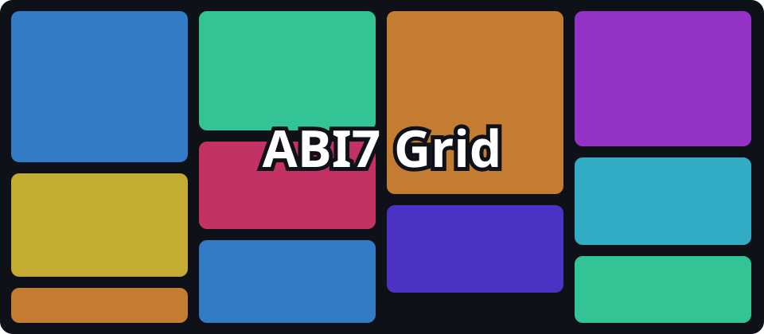

# ABI7 Grid

**A dependency-free JavaScript library for Masonry, Grid and Justified layouts — with virtualization, Drag & Drop and a plugin system.**

*Created by **Alexander Momot**. ABI7 Grid is a JavaScript grid library based on the original Abi7Grid code created by Alexander Momot.*



> **Need ABI7 Grid for commercial projects? Get a commercial license at https://abi7.com**

## License at a glance

**ABI7 Grid Community is free for non-commercial use only.**
Suitable for personal websites, personal blogs, learning, experimentation and testing.
Commercial use is not permitted without a commercial license.

**Commercial use requires a paid license.**

- **Single Developer License — $29**
- **Unlimited Developers License — $199**

Purchase: **https://abi7.com**

| Capability | Community | Single Developer | Unlimited Developers |
|---|---|---|---|
| Personal non-commercial use | Yes | Yes | Yes |
| Learning and testing | Yes | Yes | Yes |
| Commercial projects | No | Yes | Yes |
| Client projects | No | Yes | Yes |
| Commercial websites | No | Yes | Yes |
| One developer | Yes, non-commercially | Yes | Yes |
| Unlimited developers | No | No | Yes |
| Price | Free | $29 | $199 |
| Where to get it | GitHub | https://abi7.com | https://abi7.com |

Binding terms: [`licenses/LICENSE-COMMUNITY.md`](licenses/LICENSE-COMMUNITY.md) · [FAQ](licenses/LICENSE-FAQ.md). The documents are drafts pending legal review.

## Live documentation

- Documentation and live examples: **https://abilogic.github.io/abi7-grid/** *(GitHub Pages address after the first deployment of `.github/workflows/pages.yml`)*
- GitHub: https://github.com/abilogic/abi7-grid
- Commercial license: https://abi7.com

## Features

- Three built-in layouts: **Masonry**, **Grid**, **Justified** (plus a Layout API for your own).
- **Virtualization** independent of the layout: DOM Pool, overscan and adaptive overscan, Scroll Anchoring, `scrollToIndex`, pinned items, Dynamic Size Cache.
- **Partial recalculation:** inserting or removing records recalculates geometry only from the changed index.
- **Drag & Drop** (mouse and touch via Pointer Events) with auto-scroll.
- **Responsive to the container** with `ResizeObserver` (`autoResize`).
- **Plugin API** with instance isolation, compatibility and dependency checks, and automatic cleanup.
- **Safe by default:** the standard card is built with the DOM API; URLs are filtered.
- A correct `destroy()`: listeners, observers, timers, plugins and DOM.
- Async data loading with race protection (`AbortController`).

The core is exactly **two source files**: `src/abi7-grid.js` and `src/abi7-grid.css` (plus generated minified files).

## Quick start

```html
<link rel="stylesheet" href="./dist/abi7-grid.min.css">
<div id="gallery" style="height: 600px"></div>

<script type="module">
  import { ABI7Grid } from './dist/abi7-grid.min.js';

  const grid = new ABI7Grid('#gallery', {
    layout: 'masonry',                       // 'masonry' | 'grid' | 'justified' | plugin layout
    data: [{ id: 'p1', src: 'a.jpg', width: 1200, height: 800, title: 'A' } /* … */],
    layoutOptions: { gap: 12, minWidth: 180, maxColumns: 5 },
    virtualization: { enabled: true, overscan: 400 },
    animation: { enabled: true, duration: 300 }
  });

  grid.on('item:click', (e) => console.log(e.id));
</script>
```

The container must be **empty** and have a **height**. Each record needs an `id` and its size (`width` + `height`, or `aspectRatio`).

> **Delivery format: ES modules only.** There is no UMD/IIFE build and no classic `<script src>` form. ES modules do not load from `file://` pages: use a static server.

## Installation

The package is **not published to npm** yet. Copy the files from `dist/` (and the plugins you need from `plugins/`) into your project:

```text
dist/abi7-grid.js | abi7-grid.min.js (+ .map) | abi7-grid.css | abi7-grid.min.css
plugins/<name>/<name>.js [ + <name>.css ]
```

See [Installation](docs/pages/installation.md) (CDN notes, basic HTML setup) and [`docs/publishing.md`](docs/publishing.md) for the future npm release.

Rebuild the minified files from `src/`: `npm run build:lib` (esbuild is a build tool only; it is not part of the runtime).

## Basic usage

```js
grid.insert({ id: 'p2', width: 800, height: 600 }, { at: 'start' });
grid.update('p2', { title: 'Updated' });
grid.remove('p2');
grid.rebuild({ layout: 'justified', layoutOptions: { targetRowHeight: 200 } });
grid.scrollToIndex(25000);
await grid.whenReady();
grid.destroy();
```

| Layout | Idea | Main `layoutOptions` |
|---|---|---|
| `masonry` | columns; each card goes to the shortest column | `gap`, `columns`, `minWidth`, `maxWidth`, `maxColumns`, `itemHeight`, `aspectRatio` |
| `grid` | rows of equal height | `columns`, `minWidth`, `width`, `gap`/`gapX`/`gapY`, `aspectRatio`, `itemHeight` |
| `justified` | rows of equal height and varying width | `targetRowHeight`, `minRowHeight`, `maxRowHeight`, `gap`, `lastRow` |
| `horizontal` | plugin: horizontal strip | `height`, `gap`, `itemWidth` |

## API summary

```text
Lifecycle   render() refresh() rebuild(options) reload() destroy() flush() whenReady()
Data        data() setData(list) load(source) insert(items, {at}) remove(id) update(id, patch) move(id, to) getCount()
Items       getItem(id) getItems() getVisibleItems()
Navigation  scrollToIndex(i, opts) scrollToItem(id, opts)
Plugins     use(plugin, opts) unuse(name) getPlugin(name) hasPlugin(name) getPlugins()
Events      on(name, fn) once(name, fn) off(name, fn)
State       getState() isDestroyed()
Static      ABI7Grid.registerLayout() unregisterLayout() getLayouts() fromLegacyOptions()
```

Events: `ready`, `destroy`, `error`, `data:load-start`, `data:load-end`, `layout:start`, `layout:end`, `viewport:update`, `scroll`, `scroll:stop`, `resize`, `visibility:change`, `reach:end`, `item:mount`, `item:unmount`, `item:visible`, `item:hidden`, `item:click`, `item:dblclick`, `item:contextmenu`, `item:insert`, `item:remove`, `item:update`, `item:move`, `drag:start`, `drag:move`, `drag:end`, `plugin:install`, `plugin:uninstall`. Full reference: the *API Reference* section of the documentation.

## Plugin architecture

A plugin is a plain object with `name`, `version`, `apiVersion` and `install(api, options)`. It never imports the core: the core passes a frozen `api` (`events`, `features`, `layouts`, `data`, `geometry`, `viewport`, `renderer`, `options`, `lifecycle`) and removes everything the plugin registered on `unuse()` or `destroy()`.

```js
import RevealPlugin from './plugins/reveal/reveal.js';

grid.use(RevealPlugin, { stagger: 40 });
grid.getPlugin('reveal').reset();
grid.unuse('reveal');
```

| Plugin | Directory | Purpose |
|---|---|---|
| `@abi7/selection` | `plugins/selection/` | click, Ctrl/Cmd, Shift range, select all |
| `@abi7/lightbox` | `plugins/lightbox/` | viewer over the grid: keyboard, swipe |
| `@abi7/layout-horizontal` | `plugins/layout-horizontal/` | horizontal strip layout |
| `@abi7/connected-grids` | `plugins/connected-grids/` | move cards between grids |
| `@abi7/hover-effects` | `plugins/hover-effects/` | hover effects based on core geometry |
| `@abi7/reveal` | `plugins/reveal/` | reveal animation on first mount |
| `@abi7/transitions` | `plugins/transitions/` | animation presets |

Tutorial: *Building Your First ABI7 Grid Plugin* (documentation site, `docs/pages/first-plugin.md`).

## Browser support

Plain ES2022. `ResizeObserver` is used for container resizing, `IntersectionObserver` is optional, Pointer Events are used for interaction. **The automated tests run in jsdom; real-browser and touch-device testing has not been done** — test in the browsers you support.

## Limitations

- ES modules only; no UMD/IIFE; no classic `<script src>`.
- The scroll container is the grid element itself (`window` / external containers are not supported).
- With `virtualization.measure`, dynamic heights are refined only for cards that have been in the window.
- A change near the start of the list recalculates the geometry below it (O(n)).

## Repository structure

```text
src/        abi7-grid.js, abi7-grid.css — the core (+ App.tsx, main.tsx — documentation site entry)
dist/       generated: readable copies and *.min.* files
plugins/    one directory per plugin
licenses/   Community, Commercial (2), Third-party, Copyright, Trademark, FAQ
docs/       documentation site (docs/pages/*.md, app.js, ...), assets
examples/   runnable examples (also the "demo" collection of the documentation site)
tests/      Node + jsdom tests, including a run of every example
tools/      build.js (minification), check.js (repository checks)
.github/    workflows (validate, pages), issue and PR templates
```

## Development

```bash
npm install
npm run build:lib   # regenerate dist/ (readable + minified)
npm run check       # repository checks (structure, versions, licenses, links, minified sync)
npm test            # unit tests and all examples (runs on src and on the minified build)
npm run build       # documentation site -> dist/index.html (self-contained)
npm run dev         # documentation site in development mode
```

See [CONTRIBUTING.md](CONTRIBUTING.md), [CODE_OF_CONDUCT.md](CODE_OF_CONDUCT.md), [SECURITY.md](SECURITY.md) and [CHANGELOG.md](CHANGELOG.md).

## Commercial licensing

**Commercial use requires a paid license.** Single Developer License — $29. Unlimited Developers License — $199. Purchase: https://abi7.com

## Links

- Documentation: https://abilogic.github.io/abi7-grid/
- GitHub: https://github.com/abilogic/abi7-grid
- Commercial license: https://abi7.com

© 2023–2026 Alexander Momot. ABI7 Grid — created by Alexander Momot.
