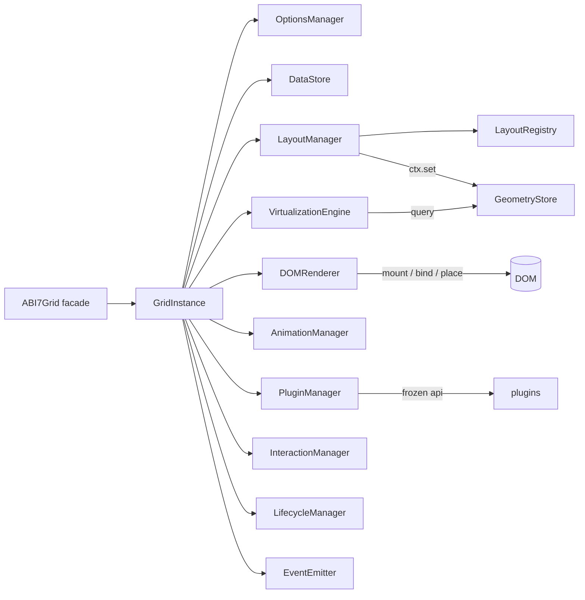
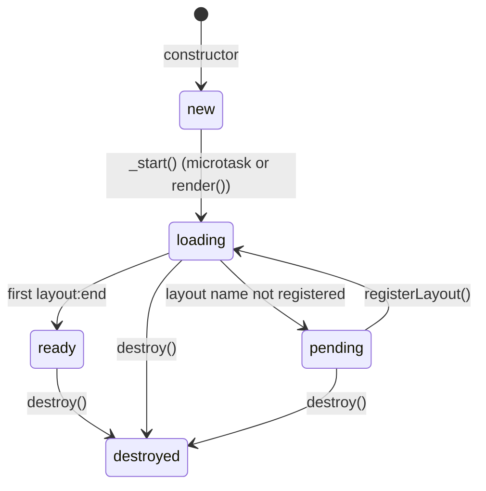
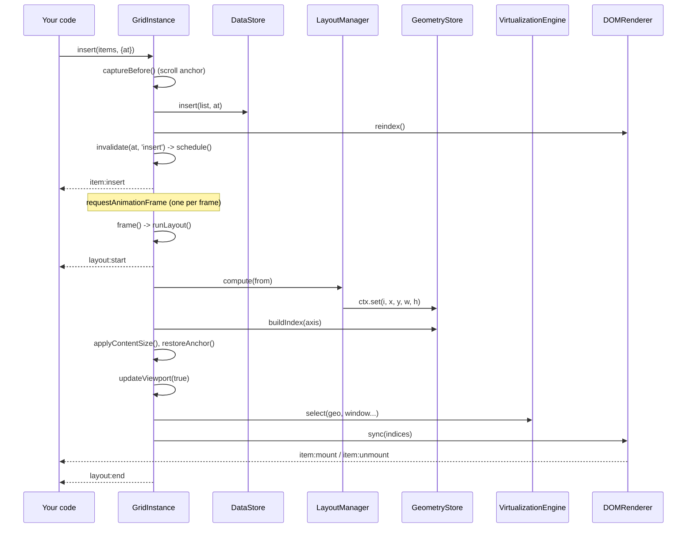

# Internal Architecture

This page is a technical map of `src/abi7-grid.js` (about 2,750 lines). It was written by tracing the code; function names are the real ones. It is intended for the maintainer.

## File structure

The file has 15 numbered sections, in dependency order:

| # | Section | What it contains |
|---|---|---|
| 1 | Utilities | `VERSION`, `ABI7Error`, `PluginError`, `mergeOptions`, `clonePlain`, `getPath`/`setPath`, `safeUrl`, a minimal semver (`parseVersion`, `satisfies`), `resolveElement` |
| 2 | `EventEmitter` | event bus, `emitCancelable`, error isolation |
| 3 | `OptionsManager` | `DEFAULTS`, merge, validation, `patch`, `set` |
| 4 | `DataStore` | records, parallel `ids` array, `Map` id → index |
| 5 | `GeometryStore` | `Float64Array` x/y/w/h + bucket index along the scroll axis |
| 6 | Layout Engine | `MasonryLayout`, `GridLayout`, `JustifiedLayout`, `LayoutRegistry`, `LayoutManager` |
| 7 | `VirtualizationEngine` | window + overscan + pinned selection, velocity tracking |
| 8 | `DOMRenderer` | mount, bind, place, unmount, DOM Pool, class registry, size observer |
| 9 | `AnimationManager` | `abi7-animating` class and CSS variables |
| 10 | `PluginManager` | `use`/`unuse`, frozen `api` objects, dependency and version checks |
| 11 | `InteractionManager` | one delegated click listener, Pointer Events Drag & Drop |
| 12 | `LifecycleManager` | `AbortController`, tracked timers and animation frames |
| 13 | `GridInstance` | the engine of one grid; connects everything |
| 14 | Public API | class `ABI7Grid`, a thin façade with a private `#c` field |
| 15 | Exports | `ABI7Grid`, `ABI7Error`, `PluginError`, `VERSION`, `API_VERSION` |

## Component diagram

## Instance lifecycle

`getState().phase` takes one of these values:

1. **Constructor** (`GridInstance`): resolves the element (`ALREADY_INITIALIZED` if `OWNERS` has it), creates managers, builds the root DOM (`_initDom`: adds class `abi7-grid`, `div.abi7-container`, saves original attributes), registers in `LIVE_INSTANCES` (a `Set` of `WeakRef`, used to notify instances when a layout is registered later). With `autoRender`, `_start()` is queued with `queueMicrotask`.
2. **`_start()`**: adds the scroll listener, measures the viewport, creates the `ResizeObserver` (`autoResize`) and `IntersectionObserver`, attaches interactions, installs plugins from the `plugins` option, sets up the layout (`pending` if its name is unknown) and calls `loadData`.
3. **First layout** (`runLayout`): sets `ready`, emits `ready`, resolves `whenReady()` waiters.
4. **`destroy()`**: see below.

## Update pipeline

### Preventing repeated recalculations

- `invalidate(from, reason)` keeps `layoutFrom = min(layoutFrom, from)` and a list of reasons; it only calls `schedule()`.
- `schedule()` returns immediately if a frame is already queued (`rafId`), so any number of calls in a frame produce **one** `frame()`.
- `frame()` runs `runLayout()` only if `layoutFrom !== Infinity`, then `updateViewport()` only if `viewDirty`.
- `onResize()` is guarded by a burst limit (10 per 500 ms) to break resize → layout → resize loops.
- `flush()` cancels the queued frame and runs `frame()` synchronously.

## Key functions

Each entry: **role**, **called when**, **arguments → returns**, **calls**, **mutates**, **side effects**.

### `GridInstance.invalidate(from, reason)`
- Marks geometry dirty from index `from`. Called by `insert`, `remove`, `update`, `move`, `_applyLoaded`, `_optionsChanged`, `onResize`, `refresh`, plugin `geometry.invalidate`.
- `(number, string) → void`. Calls `schedule()`. Mutates `layoutFrom`, `layoutReasons`.
- Side effect: queues one `requestAnimationFrame` through `LifecycleManager.raf`.

### `GridInstance.runLayout()`
- Recomputes geometry from `layoutFrom`. Called by `frame()`, `ensureLayout()` (lazy layout for geometry queries) and `flush()`.
- `() → boolean` (false if it cannot run: not started, no data, no engine, zero width).
- Calls `layoutMgr.compute(from)`, `geo.buildIndex`, `applyContentSize`, `captureAnchor`/`restoreAnchor`, `updateViewport(true)`, `anim.begin()` for animated reasons. Emits `layout:start`, `layout:end`, and `ready` on the first pass.
- Mutates `geo` (typed arrays, `epoch++`), the container's size, `scrollTop`/`scrollLeft` (after data reset or anchor restore), `ready`, `phase`.
- Errors thrown by a layout are caught and reported as `error` with `source: 'layout'`.

### `LayoutManager.compute(from)` / `makeContext(from)`
- Builds the `ctx` object for the layout (width/height minus padding, `from`, `count`, `options`, `aspect(i)`, `resolveHeight`, `set`). The layout has no access to the DOM or to the core arrays. Returns the layout's `info`, which ends up in `layout:end.info`.

### `MasonryLayout.compute(ctx)`
- Chooses columns (see [Core Concepts](#/concepts)), computes a signature `cols|w|offX|gx|gy`; if it changed, drops the saved snapshots and starts from 0. Otherwise resumes from the nearest checkpoint (every 128 cards, `LAYOUT_CHECKPOINT`) at or below `from`, and places each remaining card in the shortest column.
- Mutates its closure state (`st.sig`, `st.cp`) and calls `ctx.set` for each card.

### `GeometryStore`
- Holds `x`, `y`, `w`, `h` in `Float64Array`s and a `buckets` index (512 px) along the main scroll axis. `query(m0, m1, c0, c1, out)` returns sorted indexes crossing the window; `hit(x, y)` returns the card under a point. It knows only rectangles, so virtualization is independent of the layout.

### `VirtualizationEngine.select(...)`
- Returns indexes to mount: window ± overscan (`geo.query`) plus pinned ids. With `enabled: false` it returns all indexes. `track(pos)` smooths scroll velocity (`v = 0.4·old + 0.6·new`); with `adaptiveOverscan` the extra margin is `min(maxOverscan − overscan, |velocity| × 300)` in the scroll direction.

### `GridInstance.updateViewport(force)`
- Called after each layout and when `viewDirty`. Calls `virt.select`, `renderer.sync`, `_updateVisibility`, emits `scroll`, `viewport:update` (if something changed or `force`) and `_checkEnd` (`reach:end`).

### `DOMRenderer.sync(indices)`
- Unmounts every mounted card that is not wanted, then mounts missing ones into a `DocumentFragment` appended to the container in one operation; for cards already mounted it calls `_place`. Returns whether anything changed.
- `_mount(id, index)`: takes an element from the pool (`reused++`) or creates one (`created++`, `role="listitem"`), binds, places, and observes it when measuring.
- `_bind(ent)`: sets `className`, `data-index`, `data-id`, calls `renderItem` or `_defaultContent` (DOM API only; URL via `safeUrl`). Errors → `error` with `source: 'renderItem'`.
- `_place(ent)`: writes `transform`, `width`, `height` only if `ent.epoch !== geo.epoch`.
- `_unmount(id)`: emits `item:unmount`, calls `releaseItem`, unobserves, removes the element, pushes it to the pool up to `poolSize`.
- `toggleClass(id, cls, force)`: records the class per id (`itemClasses`) so `_baseClass(id)` re-applies it on every bind.

### `GridInstance.onScroll()` / `onResize()`
- `onScroll` sets `viewDirty`, schedules a frame, and (re)starts a 140 ms idle timer that emits `scroll:stop`. The scroll listener is `passive`.
- `onResize` compares sizes, updates `vp`, decides by the layout's `responsive` value whether to invalidate, emits `resize`.

### `loadData` / `_applyLoaded` / `setData`
- `loadData(source, kind)` increments `loadToken`, aborts the previous `AbortController`, calls a function source with `{ signal, source }`, and applies the result only if the token is still current. `_applyLoaded` replaces the store, clears caches, resets scroll on the next layout, rebinds mounted cards, emits `data:load-end` and invalidates from 0.

### `PluginManager.use(plugin, options)`
- Validates the contract and name (`/^[a-z][a-z0-9._:-]*$/i`), checks `apiVersion` with `satisfies`, checks dependencies, merges `defaults` with options (frozen), builds the frozen `api` (events, features, layouts, data, geometry, viewport, renderer, options, lifecycle), runs `install`. If installation throws, everything registered so far is rolled back.
- `unuse(name)` / `destroyAll()` run the cleanup in this order: the function returned by `install`, then `onDestroy`/`addDisposable` callbacks (reverse order), then automatic removal of subscriptions, features and layouts. Errors in cleanup are reported and do not stop later steps.

### `InteractionManager`
- Attaches one delegated listener per DOM event type to the container (not per card), plus `pointerdown` for drag. Drag listeners on `document` and `window` are added on `pointerdown` and removed in `_finish`. All listeners use the lifecycle's `AbortSignal`, so `detach()` and `destroy()` remove them with one abort.

## Teardown

`GridInstance.destroy()` runs in this order:

1. set `_destroying`, emit `destroy`;
2. `plugins.destroyAll()` (reverse installation order);
3. `interaction.detach()`;
4. abort the pending data load and bump `loadToken`;
5. disconnect the `ResizeObserver` and `IntersectionObserver`;
6. `renderer.destroy()`, `anim.stop()`;
7. `life.dispose()` — aborts the `AbortController` (all listeners), clears timers, cancels animation frames;
8. remove `div.abi7-container`, restore the root's original attributes, delete from `OWNERS` and `LIVE_INSTANCES`;
9. clear events, reset the data store, set `phase = 'destroyed'`, reject pending `whenReady()` promises with `DESTROYED`.

After this every public method throws `ABI7Error` with code `DESTROYED` (through `assertAlive()`).

## CSS interaction

The core adds classes to the root: `abi7-grid`, `abi7-layout-<name>`, `abi7-axis-x` / `abi7-axis-y`, `abi7-draggable`, `abi7-animating` (only during rearrangements) and `abi7-drag-active` during drags. It sets CSS variables `--abi7-height`, `--abi7-duration`, `--abi7-easing` on the root. Cards are `position: absolute; top: 0; left: 0` with `contain: layout paint; will-change: transform`. The transition rule applies only under `.abi7-animating`.

## Where the performance risks are

| Place | Risk | Mitigation in code |
|---|---|---|
| `runLayout` from index 0 | O(n) for edits near the start or width changes | checkpoints in Masonry; partial `from` for later edits |
| `renderItem` | runs on every bind | the standard card updates children in place |
| `sync` | mount/unmount churn on fast scroll | DOM Pool, adaptive overscan, one `DocumentFragment` |
| `measure: true` | one `ResizeObserver` entry per mounted card; measured heights trigger partial layouts | Dynamic Size Cache |
| `getState()` and plugin read methods | `data.get()` and `ids()` copy arrays | use `getByIndex` / `count` in hot paths |
| Forced reflow in `AnimationManager.begin()` | one reflow per animated rearrangement | only when animation is enabled |
